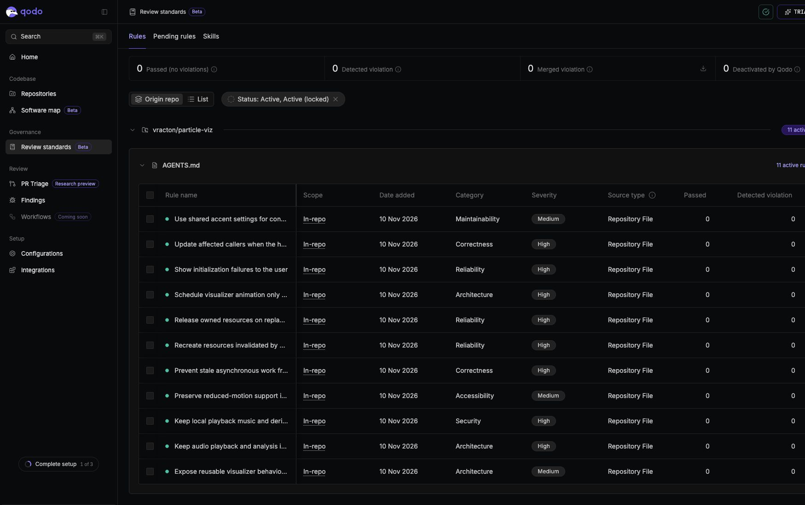

For Day 2, I added Particle Viz's [AGENTS.md](https://github.com/vracton/particle-viz/blob/main/AGENTS.md), covering the project structure, setup/check commands, and five broad project rules.

The first draft felt too tied to individual bugs from Day 1. I wanted something that could guide the whole project as it grows, so we broadened it around architecture, shared contracts, lifecycle ownership, privacy, and focused changes with evidence. The specific bugs are useful examples, but I don't want the root instructions to become a growing list of yesterday's fixes.

My most opinionated rule is the visualizer-agent access boundary under **“One host, many visualizers,”** which I'd call **“The visualizer gets an API, not the whole repository.”**

> A visualizer-building agent has a narrower role than a host/integration agent. Its task must name the visualizer files it is allowed to create or edit.

The idea behind Particle Viz is to have different agents create graphics that slot into the same music player. I want those agents working from a clear API and their own visualizer files, rather than exploring unrelated code, copying another visualizer, or rebuilding playback and controls. The host/API references are read-only, and anything outside the assigned scope needs explicit permission. For now that's an instruction boundary; a future runner will need to enforce the file-access limits.

**I thought it was cool that Qodo was able to accurately distill the broader AGENTS.md guidance into a useful set of review rules.** It imported **11 active, repository-scoped standards**. For example, the broad “Own the whole lifecycle” rule became concrete checks for stale asynchronous work, resource cleanup, initialization failures, and recovery. Seeing that translation made the instructions feel more useful: they can guide a coding agent's approach and also give the reviewer specific things to look for.

Qodo didn't turn every instruction into a review check—the visualizer-agent access boundary remains in AGENTS.md—but the extracted rules reflected the code-level concerns well. That was a useful distinction to see in practice.

[Day 2 PR](https://github.com/vracton/particle-viz/pull/2)

