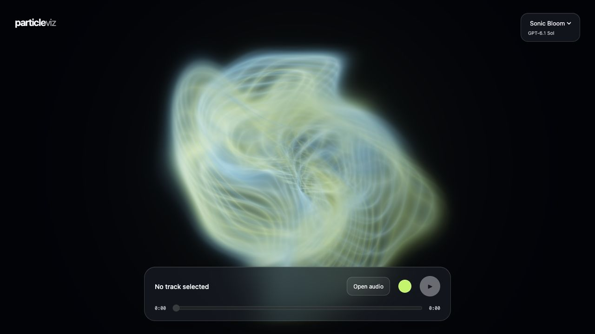

For Day 3, I used **GitHub Issues through the connected GitHub MCP tools**. I had the agent create the tickets, list the backlog, and read back the first issue with its description and acceptance criteria. Then it worked through them in order, with a separate branch and PR for each.

| Ticket | PR |
| --- | --- |
| [Simpler glass player #3](https://github.com/vracton/particle-viz/issues/3) | [#6](https://github.com/vracton/particle-viz/pull/6) |
| [Rules against excess UI text #4](https://github.com/vracton/particle-viz/issues/4) | [#7](https://github.com/vracton/particle-viz/pull/7) |
| [GPT-6.1 Sol shader #5](https://github.com/vracton/particle-viz/issues/5) | [#8](https://github.com/vracton/particle-viz/pull/8) |

I wanted the player to give the visuals more space. The old page had too much text, so the first ticket replaced it with a full-screen canvas and a small glass playback dock. The second ticket added a broader AGENTS.md rule to stop future changes from bringing back slogans, decorative tags, and repeated explanations, while keeping useful labels and errors.

**Qodo caught a layout case I hadn't checked:** at a 320x180 CSS viewport, the dock covered the visualizer selector. The usual mobile portrait check passed, but that didn't cover a short window or high zoom. I reproduced it, changed the short-height layout to allow scrolling, and added that check to the agent instructions before the next ticket.

For the shader ticket, GPT-6.1 Sol generated **Sonic Bloom**, an original organic fragment shader. The visualizer agent worked from the API and its assigned module file; the host agent handled integration. I checked separate frames to make sure time, audio energy, and accent color each changed the image.

**Another useful Qodo finding was that reduced motion stopped the picture moving but didn't stop the GPU drawing it.** The host now draws once and redraws on changes such as color, size, or graphics restoration. I checked actual draw calls: none were added during the static check, and changing the accent produced one new draw.

The browser recovery check also caught a host bug before review: disposing old GPU handles after context restoration prevented the new renderer from starting. Moving disposal to context loss fixed it. Qodo reported no issues on the instructions-only PR; I still checked that it preserved labels, accessibility, errors, and model credit.

The three PRs are reviewed and the confirmed findings are addressed. Merge and the updated Qodo rule-source sync are pending.

